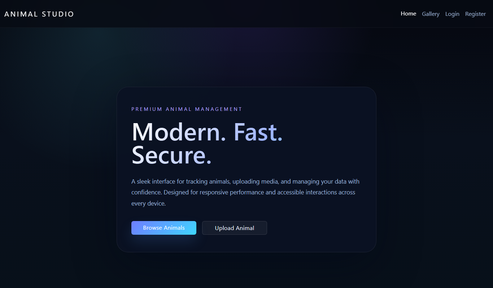
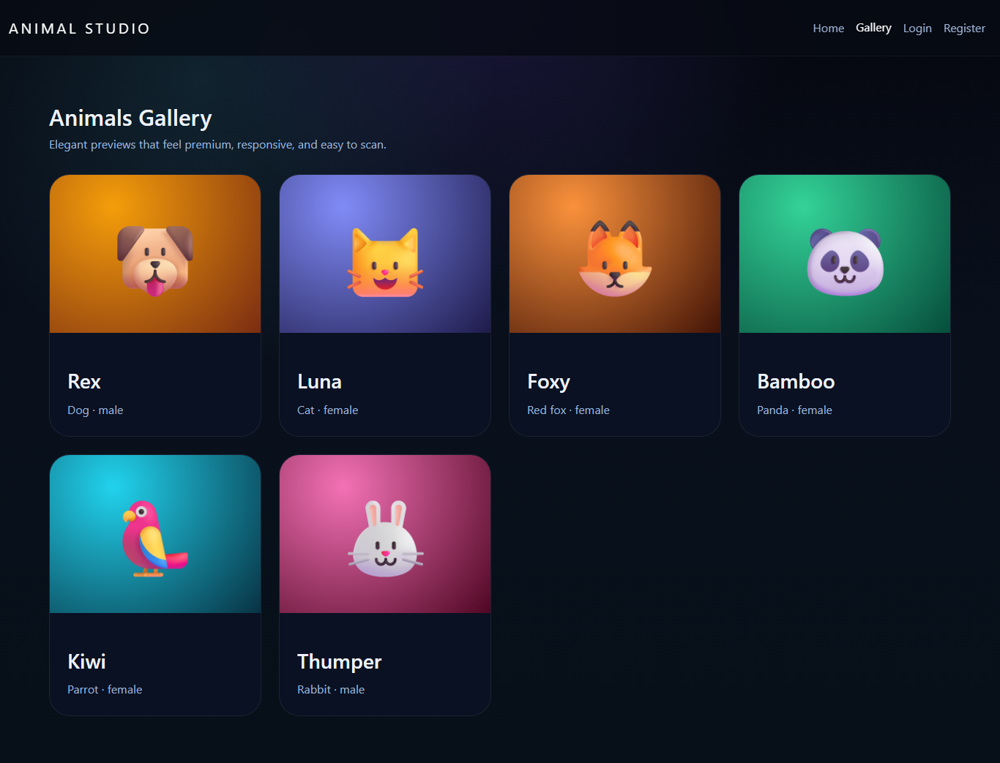
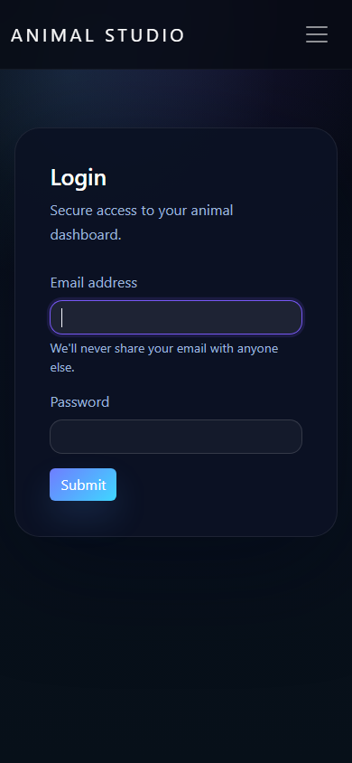

# Animal Studio

A small full-stack MERN app: register, confirm your email, log in, add animal profiles with a photo, and browse them in a responsive gallery. It is a code sample, so the focus is on a clean API, input validation, and security basics rather than on features.



| Gallery | Login (phone) |
| --- | --- |
|  |  |

## Stack

- **Client:** React 18, React Router 5, Redux Toolkit, Bootstrap 5, Axios, React Testing Library
- **Server:** Node.js, Express 4, Mongoose (MongoDB), Joi validation, JWT, bcrypt, Multer, Helmet, express-rate-limit
- **Email:** Gmail OAuth (confirmation and password-reset links)

## What it does

- Register with email confirmation, login, forgot and reset password (links are single-use)
- Add an animal (name, breed, date of birth, gender, photo) while logged in; the gallery is public
- Image uploads are checked by size, MIME type and file header; SVG is refused
- Responsive dark UI, route guard for logged-in pages, toast messages for results and errors

## Run locally

Requirements: Node.js 18+ and MongoDB (for example `docker run -d -p 27017:27017 mongo:7`).

1. Install dependencies:

   ```bash
   npm run install:all
   ```

2. Copy `server/.env.example` to `server/.env` and fill in the MongoDB and JWT values. Copy `client/.env.example` to `client/.env` if the API is not on the default URL (`http://localhost:8000/api`).

3. Start the API in one terminal and React in another:

   ```bash
   npm run start:server
   npm run start:client
   ```

Open `http://localhost:3000`. After `npm run build` the API also serves the production build at `http://localhost:8000`.

Registration needs working Gmail OAuth values (`EMAIL_EMAIL`, `CLIENT_ID`, `CLIENT_SECRET`, `REFRESH_TOKEN`) because the account is confirmed through an emailed link; without them registration fails cleanly and the account is removed.

## API

| Method and path | Auth | Purpose |
| --- | --- | --- |
| `POST /api/register` | no | Create an account and email a confirm link |
| `GET /api/confirmregister/:email/:secretKey` | no | Confirm the email address |
| `POST /api/login` | no | Returns a JWT |
| `POST /api/forgetpassword`, `POST /api/resetpassword/:token` | no | Password reset by email |
| `GET /api/animals` | no | List animals |
| `POST /api/animals` | `x-auth-token` | Add an animal with a photo (`animalimg`) |
| `POST /api/upload` | `x-auth-token` | Upload an image (`avatar`) |

## Security notes

- Protected routes need the JWT in the `x-auth-token` header; the server refuses to start without its secrets.
- Uploads accept only JPEG, PNG, GIF, WebP, AVIF and APNG, and the file header is checked as well as the MIME type.
- Login, register and password-reset routes are rate limited. Set `CLIENT_URL` to restrict CORS to your client origin.
- Passwords are hashed with bcrypt; register and login never return the hash or the confirmation key.
- `npm audit --omit=dev` is clean for the server. The client reports findings that sit in the Create React App build tooling (webpack dev server, postcss, serialize-javascript); they are not part of the code the browser runs.

## Tests

```bash
npm run test:server   # API security tests, no database needed
npm test              # React tests
npm run build         # production build of the client
```

Never commit `.env` files, passwords, JWT secrets, or uploaded user files.
